# PS1 DEV CART

PS1 DEV CART is an alternative firmware and set of tools for **PS1USB** cartridges produced by OrionSoft.

The cartridge plugs into the parallel port of the PlayStation and connects to your computer with a USB mini-B cable.
With this firmware you can:
- upload and run programs, including Net Yaroze programs;
- read and write the memory and take screenshots while your program runs;
- debug it with GDB or VS Code, and see crash reports with the function names;
- profile it while it runs;
- hot reload graphics and sounds;
- link two consoles without a cable;
- work with memory cards, 3D models, textures and sounds;
- do all of this from a Windows GUI, **PS1 Dev Cart Manager**;
- build, run and debug your projects from VS Code with the **PS1 DEV CART extension**.

Transfers are also several times faster than with the original firmware.

The firmware and all the PlayStation programs are built with the open source
[PSn00bSDK](https://github.com/Lameguy64/PSn00bSDK). No PsyQ (Sony's SDK) is needed.

## Screenshots

### On the PlayStation
**PS1 DEV CART menu**: The cartridge's menu: firmware version, device ID, and ready for the computer.

  

**SPU synth**: Six samples loaded into the synth's slots, the selected slot's settings and the keyboard.

  

**TIM viewer/Palette editor**: The TIM viewer's palette editor: each colour of the palette changed with the pad, the image redrawn live, saved back to the computer.

  

More PlayStation tools

**TMD model viewer**: A textured car model, rotated and zoomed with the pad.

  

**Crash screen**: A program that crashed: the cause, the registers and a stack dump.

  

**Sound tester**: A VAG sample loaded, with the note, the volume and the 24 voices.

  

**Link cable tester**: Two consoles linked through their cartridges: packets, losses and round trip time.

  

**Control tester**: Port 1 driven as a DualShock from the computer, port 2 empty.

  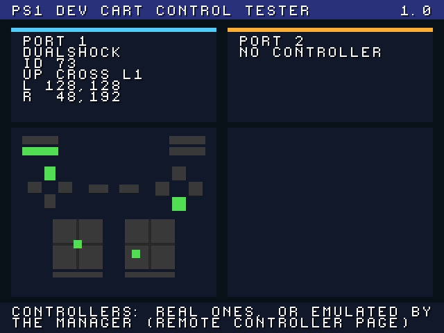

**Memory card tool**: A whole memory card backed up to the computer.

  

**Flasher**: The firmware written to the cartridge, then checked.

  

**Cheat screen**: Select + Triangle on the menu: the cheats of the disc in the drive, ticked before the game boots.

  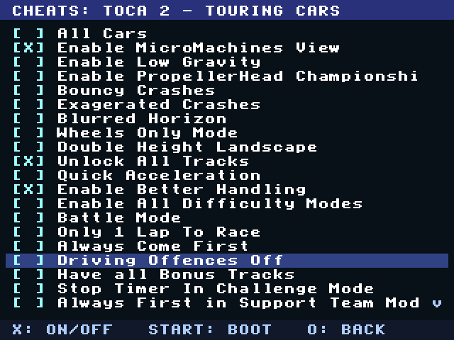

### PS1 Dev Cart Manager

**Profiler**: A 3D racing game profiled while it runs: CPU and GPU load, frames, RAM, and the functions where the time goes.

  

**Debug Server**: A crash report with the call stack and the function names.

  

**Synth**: Samples loaded into the PlayStation's SPU synth, with each slot's settings and a keyboard.

  

All the Manager pages

**Run PSX**: A PlayStation program run with its printf sent to the computer and the PCDRV file server.

  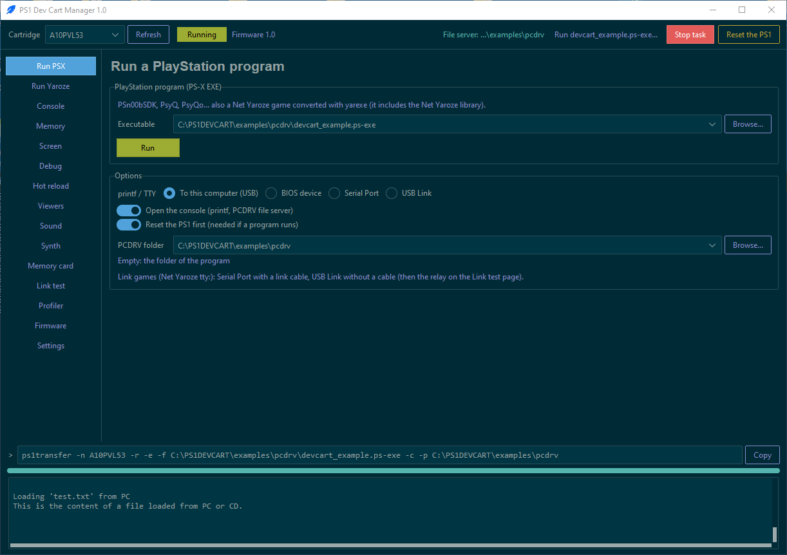

**Run Net Yaroze**: A Net Yaroze game run from its auto script and ECOFF executable, with the Net Yaroze library.

  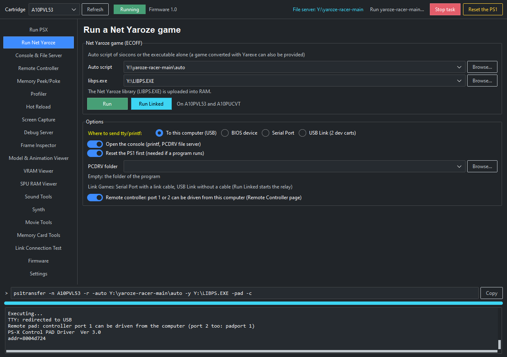

**Console & File Server**: The program's printf, and the files it opens on the computer.

  

**Remote Controller**: Controllers driven from this computer: here a DualShock in slot 1B of a multitap, in a retail game (FIFA 99), next to the real controllers.

  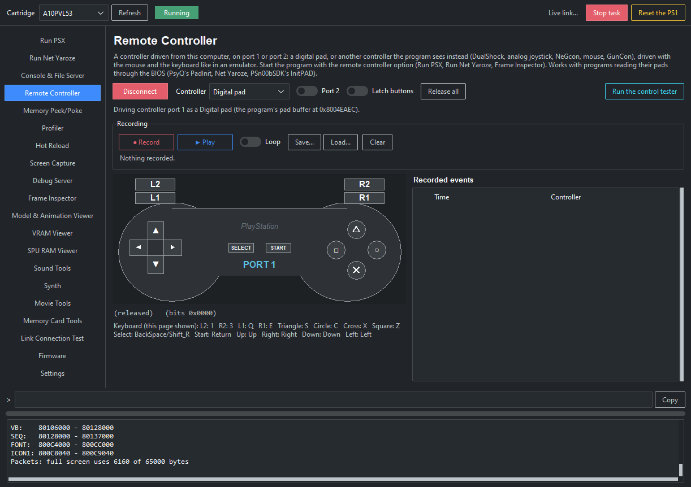

**Memory Peek/Poke**: Watch variables: the variables of a running game, read live by their symbol name.

  

**Screen Capture**: The screen of a running program, captured live.

  

**Hot Reload**: Textures sent to the running game without restarting it.

  

**Frame Inspector**: The GPU commands of a frame, each primitive listed and outlined on the frame it drew.

  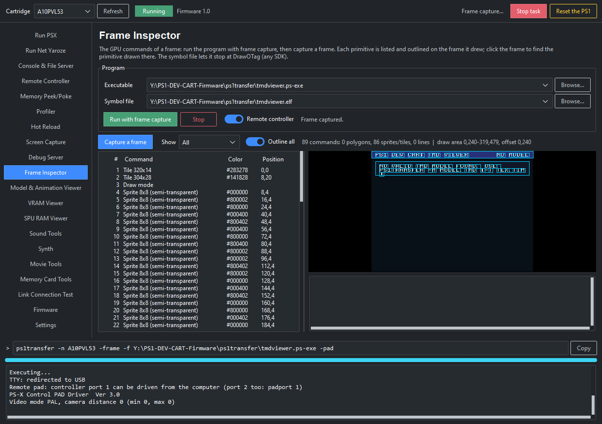

**Model & Animation Viewer**: A TMD model with its texture, its animation controls and the view, running on the PS1.

  

**VRAM Viewer**: The TIM files of the console's VRAM, outlined, with the palette of the selected TIM.

  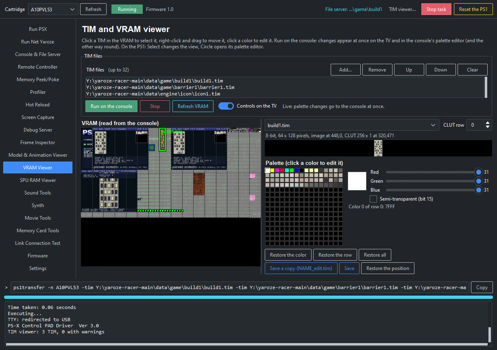

**SPU RAM Viewer**: The sound RAM of a running program: its samples, the voices playing them and the free memory.

  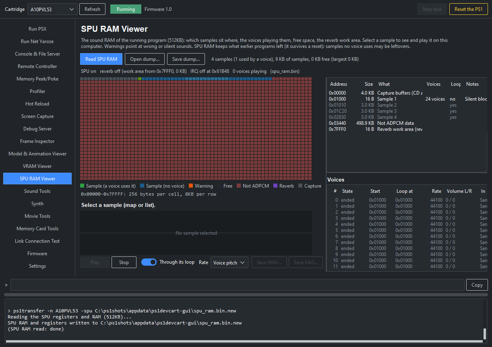

**Sound Tools**: The sound tester: a VAB bank and a VAG sample played on the PS1, with the keyboard and the voices.

  

**VAB Editor**: The VAB bank's programs, tones and key ranges, with the envelope, edited while it plays.

  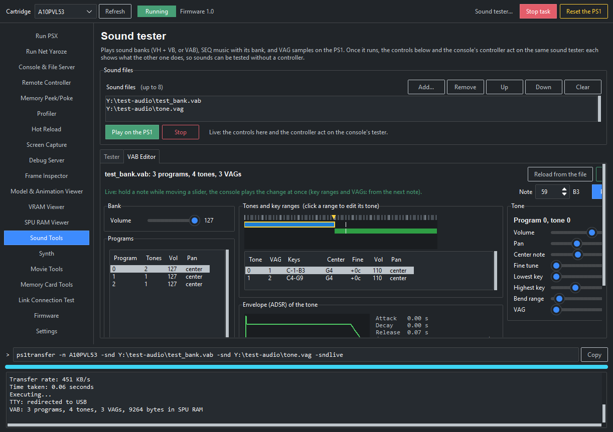

**Movie Tools**: A STR movie played on the PS1 as a game plays it from the CD, with its sound and the information on the screen.

  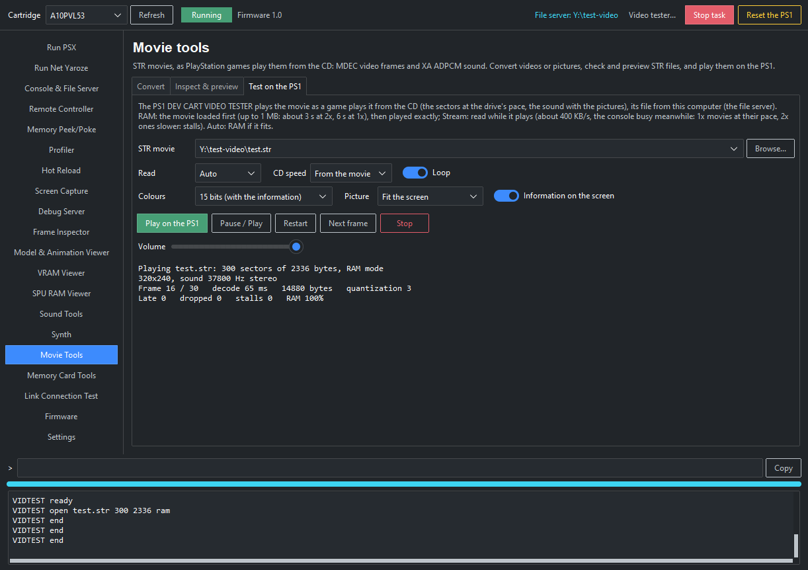

**Memory Card Tools**: The saves on a memory card image, with their icons.

  

**Link Connection Test**: The link tester running on two consoles through the USB link relay.

  

**Cheats**: The game in the drive detected, and its cheats from the cheat database, switched on while it runs.

  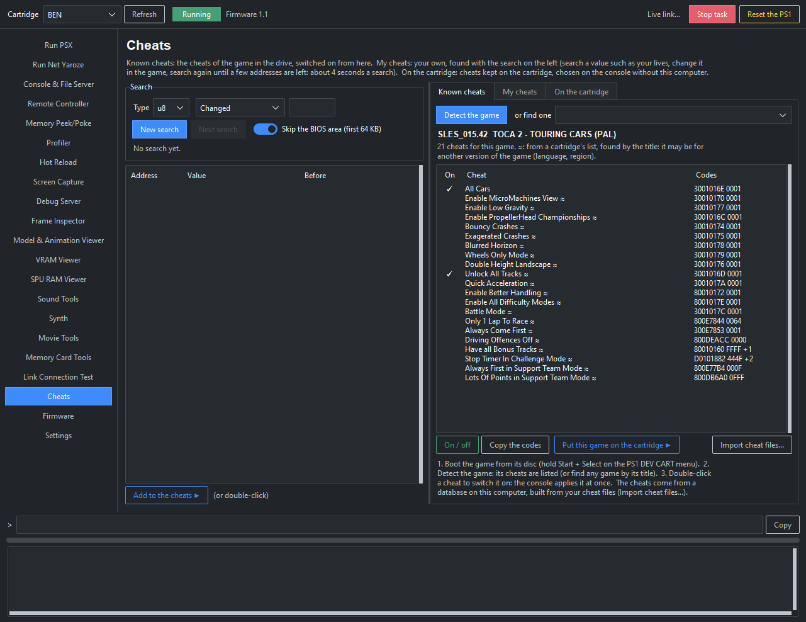

**Firmware**: The cartridge's information, and the ROM ready to flash.

  

**Settings**: The ps1transfer program, the theme and the third-party licences.

  

## About AI use in this project

Much of this project’s code was written by an AI assistant under human guidance. All features and design decisions came from a human, who also did all of the testing on real PlayStation hardware.
                                        

## Contents

- [Transfer speed](#transfer-speed)
- [Firmware features](#firmware-features)
- [Tools run on the PlayStation](#tools-run-on-the-playstation)
- [Link cable library (psxcomb)](#link-cable-library-psxcomb)
- [Using the cartridge with PsyQo](#using-the-cartridge-with-psyqo)
- [Internet through the computer (-net)](#internet-through-the-computer--net)
- [Demos](#demos)
- [Profiler](#profiler)
- [ps1transfer](#ps1transfer)
- [PS1 Dev Cart Manager (GUI)](#ps1-dev-cart-manager-gui)
- [VS Code extension](#vs-code-extension)
- [Installing the firmware](#installing-the-firmware)
- [Building](#building)
- [Technical notes](#technical-notes)
- [License](#license)

## Transfer speed

Transfers are **5 to 8 times faster** than the original firmware.

| | Original firmware | PS1 DEV CART | |
|---|---|---|---|
| Download (PlayStation to computer) | 103 KB/s | 665 to 840 KB/s | about 6 to 8× faster |
| Upload (computer to PlayStation) | 122 KB/s | 580 to 655 KB/s | about 5× faster |

Upload speeds largely depend on the computer and its USB port. The speed can also vary between different carts.

Quick test from the cartridge menu, each download checked against its upload (3 runs per size):

| File size | Upload | Download |
|---|---|---|
| 64 KB | 410 KB/s | 443 KB/s |
| 256 KB | 541 KB/s | 621 KB/s |
| 1 MB | 575 KB/s | 654 KB/s |
| 1.5 MB | 581 KB/s | 667 KB/s |
| 1.9 MB | 581 KB/s | 663 KB/s |

These are timed on the whole `ps1transfer` command, so they include starting it: small files look slower than they are.

The memory card tool reads and writes the card through the controller port registers itself, one 128-byte sector at
a time, with the BIOS driver as a fallback. Measured on an official 128KB card (1024 sectors):

| Memory card | BIOS driver | PS1 DEV CART | |
|---|---|---|---|
| Read | about 42 ms per sector (3 KB/s) | about 10 ms per sector (12.8 KB/s) | about 4× faster |
| Whole card backup (`-mcbackup`) | 43.6 s | 12.5 s | about 3.5× faster |
| Write | – | about 26 ms per sector (4.9 KB/s) | |
| Whole card restore (`-mcrestore`) | – | about 30 s (estimated from the sector writes) | |

## Firmware features

**Menu**
- Firmware version and **device ID** (the USB serial number of the cartridge, so you know which
  console is which when several are connected).
- Hold **X** at boot to initialise the CD drive.
- **START + SELECT** boots the disc in the drive (or `ps1transfer -bootcd`). The CD drive is unlocked first (the
  "nocash unlock", as in Unirom), so burned and import discs boot without a modchip or disc swapping. Not on Japanese
  consoles, whose drive can't be unlocked (licensed discs still boot). The unlock stays when the lid is opened. The
  game runs with the kernel hook: reset, memory access and screenshots from the computer, and its serial number is
  kept for the Manager's cheats (`ps1transfer -info`: `game=`).
- **Code engine**: cheats applied by the console at every interrupt while a game runs, like a cheat cartridge: up to
  216 PS1 GameShark codes (writes, tests, slides) set from the Manager's Cheats page. They stay on until the console
  is reset, without the computer.
- **SELECT + TRIANGLE** (held half a second) boots the disc with its cheats: the cheat screen lists the cheats of
  that game (found by the disc's serial number) among the ones written to the cartridge, X ticks them, START boots
  with them on, O goes back. The cartridge holds the cheats of about 50 games (20 KB), chosen in the Manager (Cheats
  page, On the cartridge tab).

**Running programs**
- Upload and execute PS-X EXE programs, reset the console from the computer.
- **Attach** (Console page of the GUI): see the printf of a program that is already running, without restarting it.
- **printf / TTY** of your program sent to the computer, or kept on the BIOS device, or a serial port "tty" driver like
  the Net Yaroze, or the same driver over USB (see the USB link below).
- **PCDRV file server**: your program reads and writes files on the computer (`psxpcdrv` folder: the usual PCDRV
  functions `PCopen`, `PCread`, ... over USB; programs including `libsn_usb.h` or `libsn.h` build unchanged).
  Only the served folder (`-p`) can be opened: paths going outside it are refused (`-pcdrvany` allows any path).
- **Net Yaroze**: games run as the Net Yaroze tools make them, with no conversion: the `auto` script of siocons
  (`ps1transfer -auto auto -y libps.exe`: its `local load` program and its `local dload` data files), or the ECOFF
  executable alone (`-e -f main -y libps.exe`). The Net Yaroze library (`libps.exe`, from your Net Yaroze boot disc)
  is uploaded and started before the program, like the boot disc does. A game converted with yarexe is a PS-X EXE
  that already includes the library: it runs like any other program.

**While a program runs**
- **Live memory access**: peek, poke, upload and download, with symbol names from your program's `.map`/`.elf`.
- **Live screenshots** of the screen or any VRAM area. The Screen Capture page of the GUI finds the screen the program
  shows on the TV by itself (**Screen on the TV (auto)**).
- **Hot reload**: TIM images to VRAM, sounds to SPU RAM and data to RAM, sent again each time you save the file.

**Debugging**

The crash screen, the GDB debugger and the profiler run from the cartridge flash (the debug monitor), not from the
PlayStation's RAM: your program keeps all its RAM.
- **Crash screen** with the cause and the CPU registers, and a **crash report** on the computer with the call stack
  and function names.
- **Last frame before the crash**: the crash screen is drawn in the buffer your program was drawing, so the frame it
  displayed last stays in VRAM (double buffered programs). The crash report saves it as a PNG (`ps1transfer -crash
  -f frame.png`, shown on the Debug page of the GUI).
- **GDB server** (`ps1transfer -gdb`), for GDB or VS Code. It supports:
  - breakpoints (also in interrupt callbacks), step/next/finish, backtrace, registers, memory, variables;
  - one hardware breakpoint and one watchpoint (read/write/access);
  - pause, then continue;
  - your program's printf shown in the debugger.
- **Frame capture** (`ps1transfer -frame`, the Frame Inspector page of the GUI): the GPU commands of a frame,
  stopped at DrawOTag between two VSync calls (any SDK, from the symbol file): every polygon, sprite, tile, line and
  draw mode with its colors, vertices, texture page and CLUT, outlined on the frame it drew.
- **SPU RAM viewer** (`ps1transfer -spu`, the SPU RAM Viewer page of the GUI): the 512KB of sound RAM of the running
  program mapped (samples, free space, reverb work area), each sample with the voices playing it, decoded and played
  on the computer, saved as WAV or VAG; warnings for the usual causes of a wrong or silent sound (a voice starting in
  free memory or inside a sample, a sample overwritten or running into the reverb work area).
- **Remote controller** (`ps1transfer -pad`, the Remote Controller page of the GUI): controller port 1 or 2 driven
  from the computer (mouse, keyboard), for programs reading their pads through the BIOS: test without a controller,
  or play the second player of a two-player game. Other controllers are emulated like in an emulator, on the real
  console: DualShock and analog joystick (sticks dragged with the mouse), NeGcon, the Sony mouse (the PC mouse) and
  the Namco GunCon (aimed at the console's picture). A game controller plugged into the computer, such as a PS1
  controller on a USB adapter, drives it too (buttons and sticks, with its own button mapping). Controller
  changes can be recorded with their timing and played back (looping or not), to replay the same input, and saved
  to a file (`.ps1pad`). With a multitap (firmware 1.1): any of its 8 slots, 1A-2D, for a game reading a multitap,
  retail games from their disc too: the game's multitap buffer is found in its RAM and the cartridge's code engine
  puts the emulated controllers in it, each slot driven by the page or its own USB controller. Without a multitap:
  a virtual one, for developers adding multitap support to their program (one reading the multitap through a pad
  buffer, such as the BIOS's InitPAD or PsyQ's libtap).
- **Profiler** (`ps1transfer -prof`, or the Profiler page of the GUI), without changing your program, see
  [below](#profiler).

**Two consoles**
- Several cartridges on one computer, chosen by serial number.
- **USB link**: two consoles linked through their cartridges and the computer, without a link cable
  (`ps1transfer -relay`).
  - A "tty" driver over USB (`-c link`) lets **Net Yaroze games** that use the serial port play
    over USB.
  - Measured to stay in sync like a link cable.
- **psxcomb**: an open source link cable library for your PSn00bSDK programs, compatible with the PlayStation link
  cable library (libcomb), over the cable or over USB (see [below](#link-cable-library-psxcomb)).

**Internet**
- **Internet through the computer** (`ps1transfer -net host:port`): the program's USB link connected to a server on
  the computer, which does the internet side (see [below](#internet-through-the-computer--net)).

**Flashing**
- `ps1transfer -flash` (or the Firmware page of the GUI) flashes a ROM, then reads the flash back and compares it.
  The GUI asks you to type the cartridge's name before it writes anything.
- **Settings** page of the GUI: the `ps1transfer` program to use and the theme (dark by default).

## Tools run on the PlayStation

`ps1transfer` uploads these programs (found next to it) with your files. They share one look (`devcart_ui.h`): a
dark blue screen, a title bar with the tool name and its state, panels for the information, and the controller
buttons in a help bar at the bottom.

| Tool | Option | What it does |
|---|---|---|
| TMD model viewer | `-m model.tmd -t texture.tim -tod anim.tod` | Shows a 3D model with its textures: rotate, zoom. Its own GTE renderer handles every TMD polygon type (flat/gouraud, textured, lit/unlit, gradation). Plays TOD animations (hierarchical objects, as PsyQ's TOD sample functions); with `-mdllive` (the GUI's Model viewer page) its controls are on the computer too, linked live with the controller's. |
| Sound tester | `-snd bank.vh -snd bank.vb -snd music.seq` | Plays the instruments of a VAB sound bank, SEQ music and VAG samples. Its own VAB/SEQ player matches Sony's libsnd. With `-sndlive` (the GUI's Sound page) its controls are on the computer too, linked live with the controller's, and the VAB editor tunes the bank live. |
| TIM and VRAM viewer | `-tim file.tim` | Up to 32 TIMs: VRAM map with overlaps, TIM view with zoom and CLUTs, warnings (overlaps, texture page crossing, CLUT position). **Palette editor** and **CLUT swap**, save/reload through the file server. |
| Memory card tool | `-mcbackup`, `-mcrestore`, `-mclist slot1`, ... | Backup (about 12 s) and restore (about 30 s) of a whole card, in slot 1 or 2 or a multitap's slot (`-slot 1b`, `slot2c`...). Browse the saves (with icons) and export, import, copy or delete one save directly on the card (only the sectors needed; writes confirmed on the console). Also works on card image files without a console. |
| SPU synth | `-synth` | The PlayStation as a 16-slot sample synth: slot n plays MIDI channel n. Samples (VAG) uploaded at any time or sent as SysEx; ADSR, reverb, pan, fine tune per slot; MIDI input. |
| Link cable tester | `-link [yaroze\|usb\|yarozeusb]` | Packets sent both ways every frame between two consoles: throughput, losses, round trip time, flow control lines. The serial cable can be used with libcomb (as games using the PlayStation link cable library) or like a Net Yaroze game (tty), or the USB link can be used instead of a cable. |
| Video tester | (Movie Tools page) | Plays an STR movie (MDEC video, XA sound) as a game plays it from the CD: the sectors at the drive's pace (1x or 2x), each frame decoded once its sectors are in, the sound with it. The movie comes from the computer through the file server: loaded into RAM first (up to 1 MB) for the exact timing, or read while it plays. STR files of 2336, 2352 or 2048-byte sectors, BS versions 1-3, up to 640 pixels wide, 15 or 24-bit colour; frame, decode time, size, quantization, late and dropped frames, sound underruns shown on the screen and sent to the computer. |
| Control tester | `-padtest` | Both controller ports as a program sees them through the BIOS: the device (digital pad, DualShock, analog joystick, NeGcon, mouse, GunCon), buttons held, sticks and analog values, a mouse pointer and a GunCon sight on the screen, the shots marked. A multitap's 4 slots too. With the remote controller option: the Remote Controller page drives it. |
| Flasher | `-flash rom.rom` | Writes the cartridge flash. Also builds a CD image to repair a cartridge (see below). |

**Palette editor** (TIM viewer): change the colours of a TIM's palette on the PlayStation and see the image redrawn
live, on the real hardware.
- Circle in the TIM view opens it. D-pad: choose the entry, L2/R2: red, green or blue, Triangle/Cross: +/- (held:
  repeats), Square: restore the row's original colours, Circle: exit.
- Start saves the TIM with its edited palette as `NAME_edit.tim` on the computer, Select reloads `NAME.tim` (e.g. after
  editing it in a paint program). Both use the file server: add `-c` (`ps1transfer -tim car.tim -c`), or use the
  TIM / VRAM page of the GUI.
- **TIM / VRAM page of the GUI**: the same TIM files shown on the computer, the VRAM with each image and CLUT outlined
  (read from the console while the viewer runs), each TIM drawn with its palette, and a palette editor (red, green,
  blue sliders, semi-transparency bit). While the console's viewer runs, a colour changed on the computer is on the TV
  at once and in the console's palette editor, and the colours changed on the console come back to the computer
  (`ps1transfer -tim car.tim -c -timlive`). The TIM shown is the same on both: choose one on the computer and the
  console shows it, change it with the pad and the computer follows. Like Sony's TIM Tool, a TIM's image or CLUT can
  be dragged (right button) to a free place of the VRAM (moved at once on the console), and saved with its new position. Save a copy (`NAME_edit.tim`) or overwrite the TIM from the page.

## Link cable library (psxcomb)

The `psxcomb` folder is a link cable library for PSn00bSDK programs, written for this project. It has the same
functions as the PlayStation link cable library (libcomb), so programs written for it build unchanged: they can keep
`#include <libcomb.h>` (a compatibility header in the folder) or include `psxcomb.h`.
- `AddCOMB()`, `DelCOMB()`, `_comb_control()` and all the `Comb...()` macros;
- the `sio:` device with `open()`, and asynchronous `read()`/`write()` (`O_NOWAIT`) ended by the `HwSIO` events
  (`EvSpIOER`, `EvSpIOEW`, `EvSpERROR`, `EvSpTIMOUT`);
- synchronous reads and writes with the wait callback.

**Over the cable** it sends the same signals as the original library (one byte per handshake with DTR/DSR), so it
links with a console running a game built with the original library. Tested with the link tester: one console on the
original library, the other on ours, no packet lost. It doesn't get stuck when an acknowledge arrives late.

**Over USB**, `CombSetLink(COMB_LINK_USB)` uses the cartridges and the computer instead of the cable, with the same
calls, no cable needed (`ps1transfer -n SERIAL1 -relay SERIAL2`).

**Speed**, measured with two consoles sending to each other at the same time:

| | Each way, top speed | | Each way, at full frame rate |
|---|---|---|---|
| libcomb, link cable, 115200 bps | about 1.6 KB/s | | |
| psxcomb, link cable, 115200 bps | about 4 KB/s | about 2.5× faster | about 1.6 KB/s |
| psxcomb, USB link | about 50 KB/s | about 30× faster | about 24 KB/s |

The top speeds cost frame rate: at 4 KB/s over the cable the link tester runs at about 7 fps, and at 50 KB/s over USB
at about 30 fps. The last column is the most each console sent while both still ran at 50 fps.

The original library checks the other console's acknowledge only in its transmit interrupt, so it often waits for
the next chance to send a byte; psxcomb checks it on a timer about twice per byte time. Both send the same signals on
the cable.

    #include "psxcomb/psxcomb.h"        // and ../psxcomb/psxcomb.c in your SRCS

    CombSetLink(COMB_LINK_USB);         // optional: USB link instead of the cable
    AddCOMB();
    ev_read = OpenEvent(HwSIO, EvSpIOER, EvMdNOINTR, NULL);
    EnableEvent(ev_read);
    fd_read = open("sio:", O_RDONLY | O_NOWAIT);
    fd_write = open("sio:", O_WRONLY | O_NOWAIT);
    CombSetBPS(115200);
    read(fd_read, buffer, size);        // ends with the event, like write()

It uses root counter 2 while a serial write is in progress, and all the time with the USB link.

## Using the cartridge with PsyQo

[PsyQo](https://github.com/pcsx-redux/nugget/tree/main/psyqo) (the C++ framework of the PCSX-Redux project) programs
work with the cartridge, with three small C libraries compiled with your program (no SDK library needed):

- **`psxdevcart`**: call `DevCartInit()` once, at the start of your application's `createScene()`. The cartridge's
  kernel hook normally runs when a program's interrupt handlers end with the BIOS `ReturnFromException`, as PsyQ,
  PSn00bSDK and Net Yaroze programs do. PsyQo lets the BIOS handle the interrupts, so without it the hook wouldn't
  run. With it: printf on the computer, live memory access and screenshots, hot reload, the profiler, the GDB
  debugger, crash reports (with the last frame) and the USB link all work, as with the other SDKs.
- **`psxpcdrv`**: files of the computer (`PCopen`, `PCread`...), with `ps1transfer -c`.
- **`psxcomb`**: **link play**, which PsyQo doesn't have: over the link cable, or over USB through the cartridges
  (`ps1transfer -relay`). Same functions as the PlayStation link cable library:
  `AddCOMB()`, then `open("sio:")` and asynchronous `read`/`write` (`syscall_open`/`syscall_read`/`syscall_write` of
  nugget), `CombSetLink(COMB_LINK_USB)` for the USB link.

`psxdevcart/example` is a PsyQo program using the three: `make NUGGET=path/to/nugget` (add `LINK_MODE=0` for the
cable). It needs a C++20 MIPS toolchain with its C++ headers (the PCSX-Redux one, see nugget's
`psyqo/GETTING_STARTED.md`; PSn00bSDK's GCC has no C++ library headers).

Rules:
- don't call `psyqo::Kernel::takeOverKernel()`: it replaces the BIOS kernel, and the cartridge's hook with it;
- don't link the program into the kernel's RAM (`TLOAD_ADDR=0x80001000`): the hook lives there;
- `psxdevcart` needs this firmware (monitor version 6); with an older one, or without the cartridge (an emulator, a
  CD), `DevCartInit()` does nothing and returns 0.

Symbols for crash reports and the profiler: `mipsel-none-elf-nm -C program.elf > program.sym` (demangled C++
names). The profiler counts `psyqo::GPU::pumpCallbacks()` as waiting: PsyQo waits for the next frame there.

## Internet through the computer (-net)

`ps1transfer -net host:port` connects the USB link of the running program (psxcomb with `COMB_LINK_USB`, or a Net
Yaroze game run with `-c link`) to a TCP server: what the program writes goes to the server, what the server sends
arrives in the program's reads. The internet side (HTTP, TLS, decoding, game servers) stays on the computer; the
PlayStation only sees bytes on its link. With `-e -f program.ps-exe` it executes the program first. It runs until
stopped (Ctrl+C, or a line on its input), and prints the throughput every second.

    ps1transfer -r -e -f game.ps-exe -net 127.0.0.1:7777     run the game, connect its link to a local server

## Demos

The `demos` folder holds programs that show what the cartridge can do.

**[PS1 PLAZA](demos/plaza/README.md)**: an online game for up to 24 PlayStations at once, showing what an online or
MMO-style game could do with the cartridge.
- **How to play:** with a PS1 DEV CART, run `demos\plaza\run.bat` on the Windows computer the cartridge is connected
  to. It starts the game on the PlayStation and connects it to the server. Without a cartridge, run
  `demos\plaza\redux.bat` to play in the PCSX-Redux emulator. Type your name and pick a free shape and colour. You're
  then in a shared world with everyone else connected, over the internet.
- **The game:** the tiles you move over take your colour, and whoever holds the most when the 3-minute round ends wins.
- **On screen:** the player list on the left, a world bigger than the screen with a minimap, and quick chat on the
  face buttons.
- **Company and watching:** a few bots are always playing, and you can watch live at https://ps1-plaza.logi26.co.uk.

  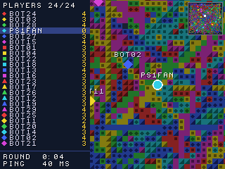

**[PS1 CO-PROCESSOR](demos/coproc/README.md)**: the computer as the PlayStation's co-processor. The PlayStation
hands work it couldn't do fast enough to the computer and shows the results live, and Select switches each scene
between the PlayStation alone and with the computer, so you can see the difference.
- **Swarm:** 1,000 units finding their way around walls you draw. It runs at 10 fps on the PlayStation alone, and
  at 49 fps when the computer runs the simulation.
- **Ray tracer:** shiny spheres with reflections and shadows, which the PlayStation's GPU can't draw.
  - On the PlayStation alone, a 160 × 112 frame takes 4.1 seconds.
  - With the computer, 9 frames a second arrive while you move the camera, compressed in the PlayStation's own
    video format and decoded by its MDEC chip.
- **Smoke:** coloured smoke you stir around pillars. The PlayStation alone simulates a 40 × 28 grid at 16 fps; the
  computer simulates 160 × 112, 16 times as fine, and sends 19 frames a second.
- **Bounced light:** a room lit by radiosity, the light bouncing from wall to wall. With the computer, the bounces
  follow the lamp live; alone, the PlayStation shows only the direct light while the lamp moves, and takes 83 seconds
  to settle once it stops.
- **Running it:** `demos\coproc\run.bat` on the computer the cartridge is connected to, or `demos\coproc\redux.bat`
  in the PCSX-Redux emulator.

  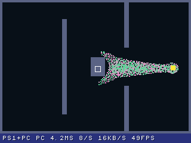
  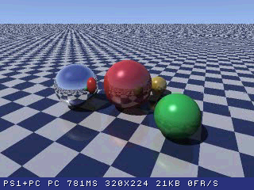
  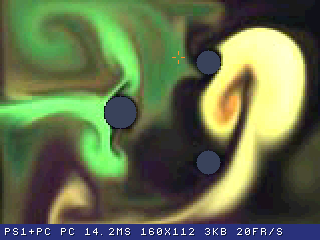
  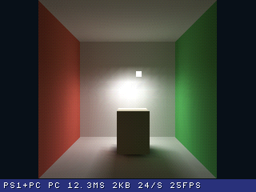

**[PS1 LIVE](demos/live/README.md)**: a small platform game that you edit on the computer **while it runs on the
PlayStation**. Every change is on the TV at once, with no rebuilding and no restart.
- **What you can change:** paint tiles, move enemies, change colours and physics, or redraw the graphics in any
  paint program. Each save is sent to the game (hot reload).
- **How:** the editor writes the running game's memory over USB (`ps1transfer -memlive`), which a normal cartridge
  can't do. Its map shows the player and enemies where they are in the game.
- **Running it:** `demos\live\editor.bat`, then start the game on the PS1 DEV CART or in PCSX-Redux.

  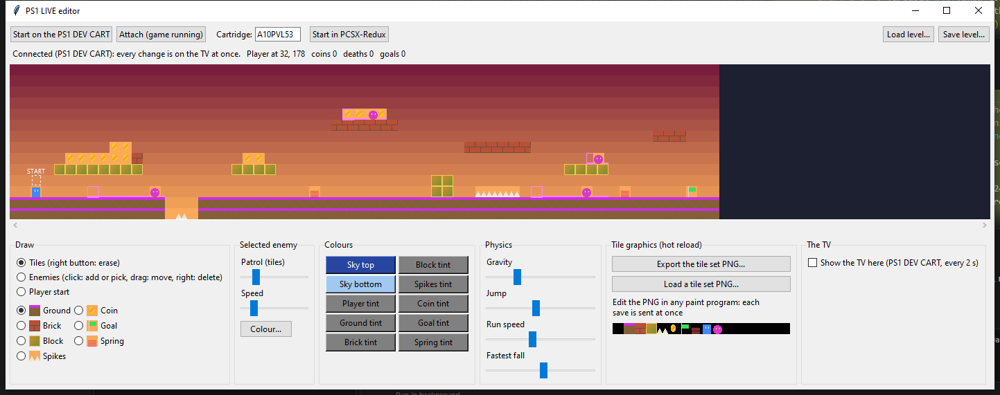

  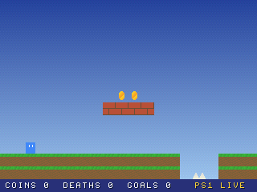
  
  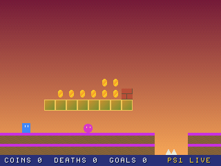

**[PS1 SLI](demos/sli/README.md)**: two PlayStations draw **one 3D scene across two screens**, 640 × 240 in all,
each drawing its half at 50 fps. It's a flight over an endless landscape, with a ship either controller steers.
- **The split:** both consoles use the same camera, with the projection centred across the two screens (the GTE's
  screen offset), and each skips the other half's polygons.
- **Lockstep:** the two run the same world in lockstep over the link cable. They exchange only their controllers'
  buttons each frame, so the computer isn't needed once it's started.
- **Running it:** `demos\sli\run.bat`, with both cartridges connected.

  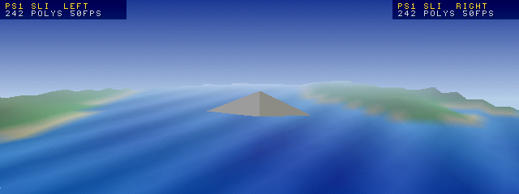
  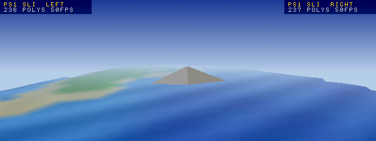
  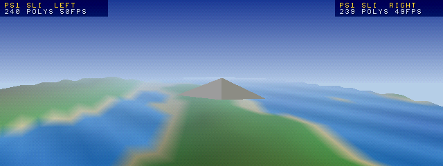

**[PS1 SLI 3 SCREENS](demos/sli3/README.md)**: the same flight on **three screens**, 960 × 240 in all: two
PlayStations and PCSX-Redux, each drawing its third, all at 50 fps.
- **The hub:** with more than two screens, the link cable isn't enough. Every screen goes through the computer
  instead (the consoles over their cartridges' USB link, PCSX-Redux over its serial port), and a hub keeps them in
  lockstep. Each frame, it sends every screen everyone's buttons together.
- **More screens:** the picture widens with the screens, each drawing its own 320 columns. Two consoles with no link
  cable work this way too.
- **Running it:** `demos\sli3\run.bat A10PVL53 A10PUCVT redux`, the screens from left to right.

  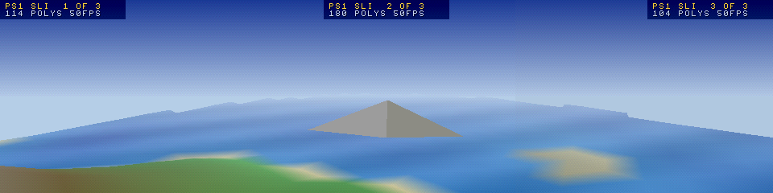
  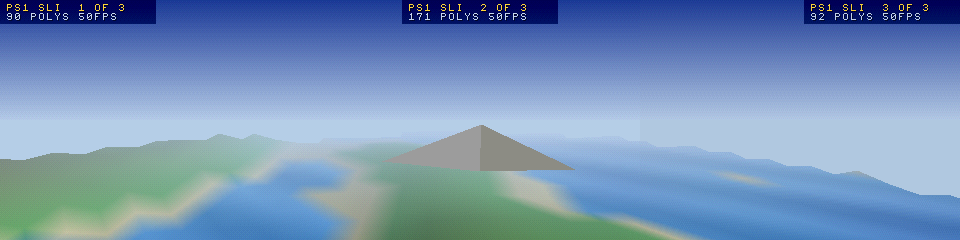
  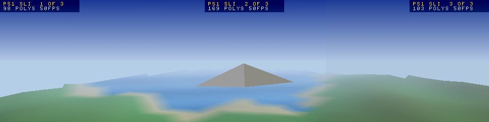

**[PS1 REWIND](demos/rewind/README.md)**: smooth rewind on a real PlayStation, like on an emulator. Hold a button
and the game runs backwards frame by frame, for minutes; let go and it goes on from there.
- **How:** a small library for programs that opt in. The game keeps its state in one block of memory (684 bytes in
  the demo). Each frame the library keeps a copy in RAM (10 seconds) and sends the computer what changed (about
  8 KB/s). Rewinding plays back from RAM, so it never waits, while older frames come from the computer to refill it.
- **The demo:** PEG DROP, balls bouncing through pegs into scoring bins. On a console, it rewound 24 seconds at ×4
  without waiting once, and each time came back to exactly the same state as the computer's copy.
- **Running it:** `demos\rewind\run.bat` on the computer the cartridge is connected to.

  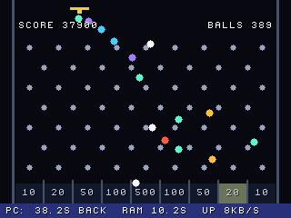
  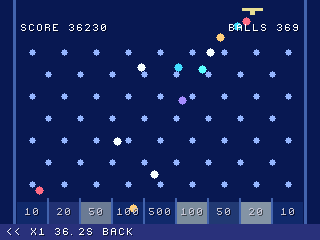

**[Radio](demos/radio/README.md)**: internet radio on the PlayStation. The computer fetches the station and encodes it
to SPU ADPCM, the PlayStation's own sound format. `ps1transfer -net` passes it to the cartridge, and the PlayStation
plays it through its SPU, with the song title on screen. It needs `pip install -r demos/radio/requirements.txt`, then
`demos\radio\run.bat` starts the server and the program. Six UK stations are filled in, and you can give other
stations or audio files instead. Left/Right changes station, Up/Down sets the volume.

  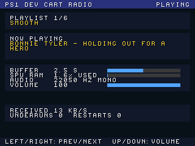

## Profiler

`ps1transfer -prof` samples the running program 1000 times a second, through the cartridge, and shows every second:
- **what limits the frame rate**, with advice: full frame rate (and the time to spare), CPU-bound, GPU-bound (the
  CPU waits in DrawSync), missing the VBlank (the frame takes a little more than the budget, so VSync waits for the
  next one: how many ms to save), capped by VSync, or waiting for the CD-ROM. Hints from the whole run: time in the
  BIOS (slow ROM code) and who calls it, printf, the function to optimise first, low free RAM, all SPU voices used,
  samples dropped;
- **CPU load** and **where the time goes**, by function (with the program's symbols: the `.elf`, `.map` or `.sym`
  next to it, a Net Yaroze ECOFF executable's own symbols, or `-sym`), with the **caller** seen in the return address
  (e.g. which function calls memcpy or the BIOS). Time in the functions where a program waits is not CPU load, and is
  shown by what it waits for: the VBlank (VSync), the GPU (DrawSync), the CD-ROM (CdSync, CdReadSync), the SPU;
  `-idle` adds your own (or a double click in the GUI), e.g. for a program without symbols. Without a waiting
  function in the symbols the CPU load includes the waits (shown with a "?");
- **GPU busy** (drawing or its DMA running), **frames per second** (swaps of the draw buffers) and the **frame time**
  against the budget of the video mode (16.7 ms NTSC, 20 ms PAL, read from the GPU: debug monitor version 7);
- **DMA activity** (GPU, SPU, CD-ROM, MDEC, ordering table clear) and the CD-ROM controller busy;
- **RAM used** of the PlayStation's 2 MB: the kernel (64 KB) and your program with its variables, plus the free RAM it
  has written since it started. With `-e`, the firmware fills the free RAM above the program with a pattern before
  starting it, and the words written since are counted, e.g. "RAM 1980/2048 KB (program 1518 KB + 398/398 KB free
  written)". Attaching to a running program measures it too if it was started with `-prof`. `-nofill`: not filled
  (not measured), e.g. if you uploaded data there yourself (the data files of a Net Yaroze auto script above the
  program turn it off). **RAM free**: the free RAM the program hasn't written, and its largest free block;
- **stack**: the lowest stack pointer seen, and the deepest since the start;
- **SPU voices** playing (envelope of the 24 voices), as a share of the 24, and the most played at once.

At the end, the averages and peaks (frames per second, CPU, GPU), the verdict for the whole run, the hints, and the
functions with their share of the time and their caller.

    ps1transfer -e -f game.exe -prof              run the game and profile it until Ctrl+C
    ps1transfer -prof 500                         profile the program already running, 500 samples a second
    ps1transfer -e -f game.exe -prof -csv prof.csv  also one line per second in a CSV file

How it works: a root counter the program doesn't use (0 by default, `-prof rate,counter`) interrupts it. The debug
monitor (in the cartridge flash) copies a small sampler to its work area in the unused kernel RAM, not the
program's RAM, and points the exception vector at it, so the ticks don't go through the BIOS
interrupt handling (about 90 µs each). At each tick the sampler sends the program counter, return address, stack
pointer and the hardware state to the computer. Measured cost: about 4% of the program's time at 1000 samples a
second (2% at 500). The sampler (hand scheduled MIPS assembly, 632 bytes) uses the debug monitor's RAM, so it can't
be used during a `-gdb` session; it works with the link tty drivers (`-c sio`, `-c link`: link play). Statistical
sampling attributes interrupt handlers' time to the code they interrupted.

## ps1transfer

The command line tool on the computer (Windows and Linux). All the options are in
[ps1transfer/README](ps1transfer/README). Some examples:

    ps1transfer -e -f game.exe -c                 run a program and show its printf
    ps1transfer -v 0 0 320 240 -f shot.png        screenshot (live while a program runs)
    ps1transfer -peek @lives -s 1                 read a variable of the running program
    ps1transfer -gdb -f game.exe                  debug with GDB / VS Code (target remote localhost:3333)
    ps1transfer -e -f game.exe -pad               run a program whose pad can be driven from the computer
    ps1transfer -hot sprite.tim -watch            hot reload a texture each time it is saved
    ps1transfer -e -f game.exe -prof              profile a program (CPU/GPU load, functions, RAM...)
    ps1transfer -mclist slot1                     list the saves of the memory card in slot 1
    ps1transfer -n SERIAL1 -relay SERIAL2         USB link between two consoles
    ps1transfer -l                                list the connected cartridges

Windows needs the FTDI D2XX driver; Linux needs libftdi1.

## PS1 Dev Cart Manager (GUI)

A window for `ps1transfer` (Python, or a single `.exe` without Python), so you don't have to remember the options.
Each page shows the command it runs. See [gui/README.md](gui/README.md).

| Page | |
|---|---|
| Top bar | Cartridge chooser (by device ID), its state (menu, running, stopped, crashed) and firmware; the folder served while the file server runs; stop task, reset. |
| Run PSX | Upload and run a PlayStation program (PS-X EXE); TTY mode, file server; **Run Linked** starts it on two cartridges. |
| Run Net Yaroze | Upload and run a Net Yaroze game (auto script or ECOFF executable, with libps.exe); TTY mode, file server; **Run Linked**. |
| Console & File Server | printf of the running program, **Attach** to one already running; file server activity (files opened, created and refused, bytes read and written). |
| Remote Controller | Controller port 1 or 2 driven from the computer (mouse, keyboard), for programs reading their pads through the BIOS: a digital pad, DualShock, analog joystick, NeGcon, mouse or GunCon; record and play back controller sequences. |
| Memory Peek/Poke | The program's variables from its symbol file, a watch list with live values (typed, editable), peek, poke, upload, download. |
| Cheats | Finds a value in the RAM of the running game, a retail game booted from its disc too (equal to a value, or changed, increased, decreased since the last search: about 4 seconds a search), then keeps it: cheats frozen or written once, a list per game, GameShark / Action Replay codes in and out. **Known cheats**: the game booted from its disc is detected and its cheats listed from a database built from your own cheat files and game lists (switch them on). **On the cartridge**: the games whose cheats the cartridge keeps (read, add, remove, space left, write), chosen on the console with Select + Triangle. |
| Profiler | Runs (or attaches to) a program, a Net Yaroze game too, and shows live what limits its frame rate with hints, CPU/GPU load, where the time goes, frame time, RAM used and free, stack, DMA, SPU voices and the functions with their callers. |
| Hot Reload | Files and where they go, sent at once or each time they are saved. |
| Screen Capture | Screenshots, live while a program runs, with automatic refresh; **Screen on the TV (auto)** finds the screen the program shows. |
| Debug Server | Crash report, GDB server. |
| Frame Inspector | The GPU commands of a frame (polygons, sprites, tiles, lines...) listed and outlined on the frame it drew. |
| Model & Animation Viewer | TMD model viewer with its textures and TOD animations, its controls live on the computer and the controller (TOD, frame, play, loop, speed, view). |
| VRAM Viewer | TIM and VRAM viewer on the console and on the computer: the VRAM with the TIMs outlined, each TIM with its palette, a palette editor live on the console. |
| SPU RAM Viewer | The sound RAM of the running program: samples, free space, reverb work area, the voices using each sample; play a sample on the computer, save it as WAV/VAG; warnings for wrong or silent sounds. |
| Sound Tools | Sound tester with up to 8 files, its controls live on the computer and the controller (program, note, keyboard, volume, SEQ, voices); VAB editor: the bank tuned live on the console (volume, pan, key ranges, tuning, ADSR envelope), saved as a VAB. |
| Synth | 16 slots, keyboard, WAV to VAG conversion, MIDI input, SysEx, kits. |
| Movie Tools | STR movies, like Sony's MovConv: a video (any format FFmpeg reads) or pictures (TIM, PNG, JPG: a slide show with fades, or frame by frame) with its sound or a sound file made into an STR (resolution, TV shape and fit, frame rate, 1x/2x drive speed, quality, XA sound 37800/18900 Hz mono/stereo; video and sound interleaved as the drive reads them, CD error codes included for disc images); any STR checked frame by frame and previewed with its sound; played on the console by the video tester. |
| Memory Card Tools | Backup/restore, save browser with icons, on a card or an image file. |
| Link Connection Test | Link tester on two consoles, USB link relay for your own programs. |
| Firmware | Cartridge information, flashing with a typed confirmation and a readback check. |
| Settings | The ps1transfer program to use, and the theme (dark by default). |

## VS Code extension

The **PS1 DEV CART** extension builds, runs and debugs PlayStation projects from VS Code: Net Yaroze (built in WSL),
PsyQ / PsyQo (the PSX.Dev templates) and PSn00bSDK projects, in the PCSX-Redux emulator or on a PlayStation with the
cartridge.

  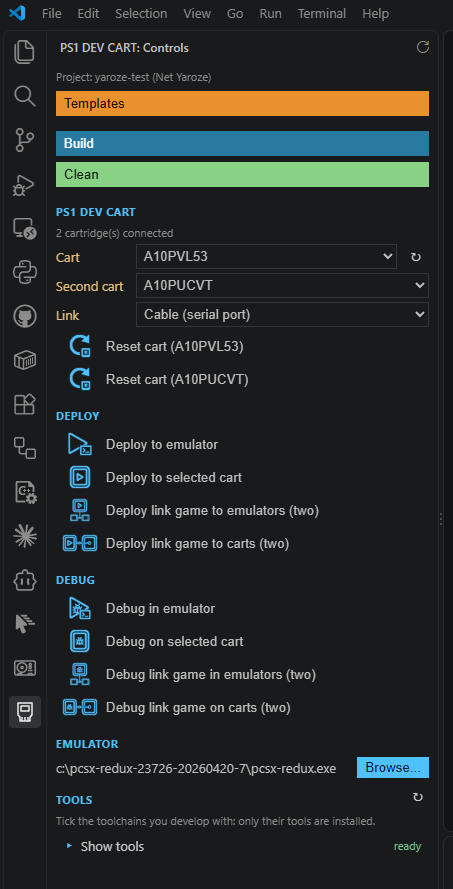

- **Build, Run and Debug** buttons in the status bar and in the PS1 DEV CART panel; compiler errors in the Problems
  panel.
- **Run on PS1** and **Debug on PS1**: the program runs on the console with its printf in a terminal and the PCDRV
  file server; breakpoints, stepping and variables through the cartridge's GDB server.
- **Link play**: run or debug a link game on two emulators, or on two consoles (link cable or the USB link).
- **New projects** from templates, IntelliSense for the SDK headers, PNG to TIM conversion, CD images.
- **Installs the tools** a project needs: the MIPS toolchain, PSn00bSDK, CMake, Ninja, and the Net Yaroze build
  environment in WSL.
- Comes with `ps1transfer` and the PlayStation tools: nothing else is needed to use the cartridge from VS Code.

**Installing**
1. Download the release zip and unzip it: the extension is the `ps1-dev-cart-x.y.z.vsix` file.
2. In VS Code, open the **Extensions** view (Ctrl+Shift+X), click the **...** menu at its top and choose **Install
   from VSIX...**, then pick the file. Or from a terminal: `code --install-extension ps1-dev-cart-2.6.3.vsix`.
3. Open your project's folder: the PS1 DEV CART icon appears in the activity bar, with the panel and its buttons.

The extension's own documentation is in [vscode-extension/README.md](vscode-extension/README.md). To build the `.vsix`
yourself: `npm run package` in the `vscode-extension` folder.

## Installing the firmware

**Warning:** flashing the wrong file, or interrupting a flash, can leave the cartridge unable to boot. If that
happens, it can be repaired with the flasher CD image (below).

- **From the computer:** with the cartridge on its menu, run `ps1transfer -flash cartrom/ps1devcart.rom`, or use the
  Firmware page of the GUI. The ROM is checked first, flashed, then read back and compared.
- **Repair or install from a CD:** `make` in the `ps1-tools/ar_flash` folder also builds `ar_flash.bin`/`ar_flash.cue`, a CD image
  with the flasher. Burn it to a CD-R or use a CD emulator. Then:
  1. Start the console with the cartridge switch **OFF**.
  2. Boot the CD.
  3. Switch the cartridge **ON** before flashing.

## Building

**Requirements**
- [PSn00bSDK](https://github.com/Lameguy64/PSn00bSDK) (tested with the v0.24 release package and its GCC 12
  toolchain) for the firmware and the PlayStation tools.
- [nolibgs_hello_worlds](https://github.com/ABelliqueux/nolibgs_hello_worlds) for the build rules of the kernel hook
  (no library of it is linked).
- `make`, Python 3 (menu images, GUI), a host C compiler for `ps1transfer` and `cartrom/rom_rounder`.
- Copy `config/Makefile.conf.example` to `config/Makefile.conf` and set `PSN00BSDK` and `PSXDIR`.

**Build steps**

    make                            firmware (ps1devcart.ps-exe), kernel hook, debug monitor
    make -C cartrom                 cartridge ROM (cartrom/ps1devcart.rom)
    make -C ps1-tools/ar_flash      flasher, with the ROM built in, and its CD image
    make -C ps1-tools/tmdviewer     (same for soundtest, timviewer, cardtool, synth, linktest, padtest, videotest)

`build.sh` / `build.bat` build everything. `ps1transfer` has Makefiles for Windows and Linux
(`Makefile_win`, `Makefile_linux`) and Code::Blocks projects.

Windows (MSYS make): if the compiler says "Cannot create temporary file in C:\Windows\\", pass the temp folder to make:
`make TMP="$(cygpath -w $TEMP)" TEMP="$(cygpath -w $TEMP)"`.

**Testing a firmware without flashing:** `make RAMTEST=1` builds a version that runs from RAM (0x801D0000), with the
debug monitor copied to RAM. Run it from the cartridge menu with `ps1transfer -r -e -f ps1devcart.ps-exe -c off`.

**Optional:** `make psyq` in `linktest` builds `linktest_psyq.ps-exe`, the link tester with the original PsyQ
library, to compare with ours (`ps1transfer -link -f linktest_psyq.ps-exe`). It needs your own PsyQ and is not
included.

## Technical notes

- **What each part is built with:**
  - **No SDK** (plain GCC, no library linked): the **kernel hook** (`kernel_hook/`, resident in the BIOS's unused
    kernel RAM while a program runs) and the **debug monitor** (`monitor/`, run from the cartridge flash: crash
    screen, GDB server, profiler, hot reload, live screenshots). The profiler's sampler and the hook's debug exception
    vectors are hand written MIPS assembly. These are the parts where size and timing matter most, and they work
    whatever SDK your program uses.
  - **PSn00bSDK**: the **menu firmware** (`ps1devcart.c`) and the **PlayStation tools** (`ps1-tools/`: TMD, TIM and
    sound viewers, SPU synth, memory card tool, link tester, flasher), for the GPU, the debug
    font, pads, SPU and memory cards.
  - **Libraries for your programs**: `psxpcdrv` (files on the computer), `psxcomb` (link play) and `psxdevcart`
    (PsyQo programs) are plain C compiled with your program, no SDK library; they work with PSn00bSDK and PsyQo (see
    [Using the cartridge with PsyQo](#using-the-cartridge-with-psyqo)).
- The menu runs from RAM at 0x801EF000: it is copied there from the cartridge flash at boot (`cartrom`, based on
  PSn00bSDK's cartrom example), as the original PS1USB firmware does at the same address. It takes 34.1 KB there
  (0x801EF000 to 0x801F7854, code, data and variables), the original firmware 65.2 KB (up to 0x801FF4E8). This RAM
  is only used while the menu is shown: a program you run gets all the PlayStation's RAM (it can load over the
  menu). What stays while it runs is the kernel hook, in the BIOS's unused kernel RAM (below), as with the original.
- Flash (128KB):
  - firmware at the start;
  - menu images at 0x1F010000 (a small file system of TIMs, edited with `cartrom/tfs_tool.py`);
  - debug monitor at 0x1F019000;
  - device ID saved in the last sector (0x1F01F000).
- The **kernel hook** (0x8000C160 to 0x8000DF7F, unused kernel RAM) answers the computer while a program runs: memory
  access, reset, TTY, USB link. Its parameters are at 0x8000DF70 (TTY mode, packet size, features, pointer to its USB
  service, which tools also call directly to answer faster).
- The VRAM is saved to RAM (0x80020000) at boot, so `-v` from the menu shows the last screen before a reset or crash.
- The transfer protocol is in `usb.h` (commands with CRC8, data packets with CRC and acknowledge). This firmware also
  has escaped answers: a `Q` byte before a command makes its answer "DLE g" / "DLE b" instead of `G` / `B`, so text a
  program prints on the USB tty can't be taken for it. Our ps1transfer asks for them; without `Q` (e.g. the original
  ps1transfer) the answers stay the same.
- `psyq_compat.h` holds the few PsyQ calls the programs used that PSn00bSDK doesn't have (pads in PsyQ's bit layout,
  `ClearImage`, display set-up). `psn00b_tool.mk` has the shared build rules of the tools.

## License

Mozilla Public License 2.0, see [LICENSE](LICENSE). Some source files keep the notices of their original authors, as
the license requires. Third-party parts:
- `cartrom/nugget`: MIT license (PCSX-Redux authors).
- `ps1transfer/lodepng.c`, `lodepng.h`: LodePNG by Lode Vandevenne, zlib license (notice in the files).
- `ps1transfer/ftd2xx.dll`, `ftd2xx.h`, `ftd2xx.lib`: FTDI D2XX driver, FTDI's driver licence (redistributable with
  products using FTDI chips: https://ftdichip.com/driver-licence-terms/).
- The firmware and the PS1 tools are built with PSn00bSDK (Mozilla Public License 2.0), parts of its libraries are in
  them.
- The PS1 Dev Cart Manager executable (`gui/dist`, made with PyInstaller) contains Python (PSF license), ttkbootstrap
  and Pillow, mido and python-rtmidi (MIT/HPND style licenses).
- The crash screen is based on the PS1 Crash Handler by Spencer Alves (public domain).
- The software reset and the first kernel hook were contributed by david4599 (https://github.com/david4599/ps1usb/).

## Credits
- OrionSoft for the PS1USB device, original firmware, original PS1Transfer tool and the flasher tool (https://github.com/OrionSoftGames/ps1usb)

