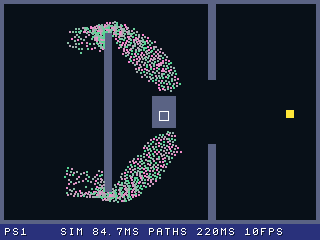
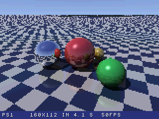
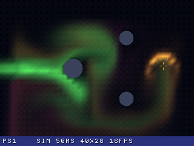
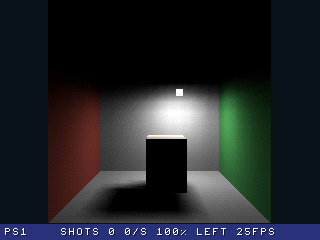

# PS1 CO-PROCESSOR

The computer as the PlayStation's co-processor. Through the PS1 DEV CART, the PlayStation hands work it couldn't do
fast enough to the computer, and shows the results live. The link becomes a way to extend the hardware, not just a
cable for loading programs.

Each scene runs two ways, and **Select** switches between them while it runs:
- **PS1:** the PlayStation does everything itself.
- **PS1+PC:** the computer does the heavy work.

The bar at the bottom shows how long the work takes and what goes over the link.

## Swarm: 1,000 units finding their way

1,000 units flow around walls to a target. Each one follows a path field (the best direction from every square of an
80 × 56 grid to the target, around the walls), and is pushed away from the units close to it, 50 times a second.

  
  

| | PS1 | PS1+PC |
|---|---|---|
| A simulation step | 84 ms | 4.5 ms (on the computer) |
| Frame rate | **10 fps** | **49 fps** |
| Working out the paths (each time the target or a wall moves) | 220 ms (a pause) | 35–50 ms, on the computer |
| Link | – | about 16 KB/s, 8 updates a second |

- **With the computer,** it runs the whole simulation and sends the units' movements, 2 bytes each. The PlayStation
  only draws them, moving them smoothly between two updates.
- **The data is paced:** the next update goes once the PlayStation has the last one, so it adapts to the link.

| Button | |
|---|---|
| D-pad (R1: faster) | Move the cursor |
| Cross | Move the target to the cursor |
| Square (hold) | Draw walls, or rub them out if you start on a wall |
| Triangle | Start again |
| Select | PS1 / PS1+PC |
| Start | Back to the menu |

## Ray tracer: a scene the PlayStation can't draw

Shiny spheres reflecting each other and a checkered floor, with shadows and highlights. The PlayStation's GPU can't
draw this, because it has no reflections and no per-pixel lighting.

  
  

| | PS1 | PS1+PC |
|---|---|---|
| A 160 × 112 frame | **4.1 seconds** | about 50 ms: **9 frames a second** while the camera moves |
| When the camera stops | – | 320 × 224 with 4 rays a pixel, in under a second |
| Link | – | 5.5 KB a frame (about 50 KB/s while moving); 22 KB for the still frame |

- **With the computer,** it ray traces what the PlayStation's camera sees and sends it compressed in the
  PlayStation's own video format (MDEC, as in STR videos). The PlayStation's MDEC chip decodes it.
- **Alone,** the PlayStation ray traces the same scene itself in fixed-point maths, a few rows each frame.

| Button | |
|---|---|
| D-pad (R1: faster) | Turn and tilt the camera |
| Triangle / Cross | Move closer / further away |
| Select | PS1 / PS1+PC |
| Start | Back to the menu |

## Smoke: a fluid you stir

Coloured smoke that you push around with the cursor. It swirls around three pillars, and a wind blows from the left,
changing colour now and then. Both sides simulate the same fluid with the same method ("stable fluids": the smoke and
the flow carried along the flow, then the flow made incompressible), but at very different resolutions.

  
  

| | PS1 | PS1+PC |
|---|---|---|
| Grid | 40 × 28 (cells of 8 pixels) | **160 × 112**, 16 times as many cells (cells of 2 pixels) |
| A simulation step | 49 ms | 14 ms (on the computer), 50 steps a second |
| Frame rate | **16 fps** | **19 frames a second** |
| Pressure iterations | 6 | 40 |
| Link | – | 3 KB a frame (about 55 KB/s) |

- **Alone,** the PlayStation simulates in fixed point, and draws the grid as about 1,000 smoothly shaded quads. The
  smoke is blurry, and steps around the pillars.
- **With the computer,** it simulates the fine grid and sends each frame in the PlayStation's own video format (MDEC),
  as for the ray tracer. The PlayStation sends the controls each frame, and draws the pillars and the cursor on top.
- **Two frames can be on their way** at a time, so the link stays busy.

| Button | |
|---|---|
| D-pad (R1: faster) | Move the cursor |
| Cross (hold) | Push smoke the way the cursor moves |
| Square | Next colour |
| Circle | Wind on/off |
| Triangle | Clear the smoke |
| Select | PS1 / PS1+PC |
| Start | Back to the menu |

## Bounced light: a room lit by radiosity

A room open at the front, with a red wall, a green wall and a box, lit by a lamp facing down. The light bounces from
wall to wall: the ceiling, which the lamp doesn't reach, is lit by the floor; the red wall tints the room pink; the
box's shadow is soft and greenish. Every surface is made of 777 patches, and each patch's light comes from the lamp
and from all the other patches (radiosity, with the box in the way or not). The PlayStation draws the room with its
Gouraud shading in both modes; only the lighting changes.

  
  

| | PS1 | PS1+PC |
|---|---|---|
| While the lamp or the box moves | **Direct light only**: a black ceiling, black shadows | **All the bounces, live** |
| A new lighting | 83 seconds to settle (1,083 shots, 12 a second); a third of it still missing after 20 seconds | 12–15 ms on the computer, 25 a second |
| Moving the box | The same | 125 ms more on the computer (the form factors again) |
| Frame rate | 25 fps | 25 fps |
| Link | – | 2.3 KB each time (a colour a patch) |

- **Alone,** the PlayStation uses progressive radiosity in fixed point: the lamp's light at once, then the patch with
  the most light not sent yet sends it to all the others, as many as fit in 12 ms a frame. It starts again from the
  lamp at every change, so while you move something you only see the direct light.
- **With the computer,** it works out the form factors between all the patches when the box moves (600,000 pairs),
  then 24 bounces for every change of the lamp, and sends a colour a patch. Once settled, the PlayStation's room looks
  the same: it's the same method.

| Button | |
|---|---|
| D-pad (R1: faster) | Move the lamp (left/right, back/forward) |
| L1 / L2 | Lamp up / down |
| Square (hold) + D-pad | Move the box |
| Circle | Lamp colour: white, warm, cool |
| Triangle | Start again |
| Select | PS1 / PS1+PC |
| Start | Back to the menu |

All the figures above were measured on a PAL PlayStation with a PS1 DEV CART, and a Windows PC.

## Running it

The co-processor runs on your own computer. You need Python 3 with numpy:

    pip install -r requirements.txt

**On a PlayStation with a PS1 DEV CART:** run this on the computer the cartridge is connected to:

    run.bat

It opens the co-processor server in its own window, sends the program to the PlayStation and starts it, then
stays open as the bridge between the cartridge and the server. With more than one cartridge, add `-n SERIAL`
(`ps1transfer -list` shows them).

**In the PCSX-Redux emulator (no cartridge needed):**

    redux.bat

It starts the server, then PCSX-Redux with the program, and connects the emulator's serial port to the server. It
finds PCSX-Redux on the PATH or in the PSX.Dev extension for VS Code, or use `redux.bat -Redux C:\path\to\pcsx-redux.exe`.
In the emulator, the swarm ran at 59 fps with the computer, and the ray tracer at 10 frames a second.

**Without the computer:** the program still works, in PS1 mode only. The menu shows whether the computer is
connected.

## How it works

The link is the same as in the other demos: psxcomb's USB link and `ps1transfer -net` on a console, the serial
port and a bridge in PCSX-Redux. The program reads and writes the link without ever waiting, so the screen keeps
moving while results are on their way.

- **[coproc_server.py](coproc_server.py)** is the co-processor. It runs the swarm simulation, the ray tracer, the
  smoke and the radiosity (numpy), and compresses frames with [mdec_encoder.py](mdec_encoder.py).
- **[coproc.c](coproc.c)** is the PlayStation program. It draws everything, decodes the frames with the MDEC, and has
  the PS1 versions of the four scenes, following the same rules as the server, so the two modes can be compared.
- **[coproc.h](coproc.h)** describes the messages between them.

The pattern works for any heavy job: the PlayStation sends what it needs (a camera, a target, a game position), and
the computer sends back a compact result, a few KB at most.

## Building

`coproc.ps-exe` is included. To build it, with PSn00bSDK set in `config/Makefile.conf` as for the PlayStation tools:

    make

It uses the repo's psxcomb (`../../psxcomb`) and `psn00b_tool.mk`, and PSn00bSDK's `psxpress` for the MDEC.
