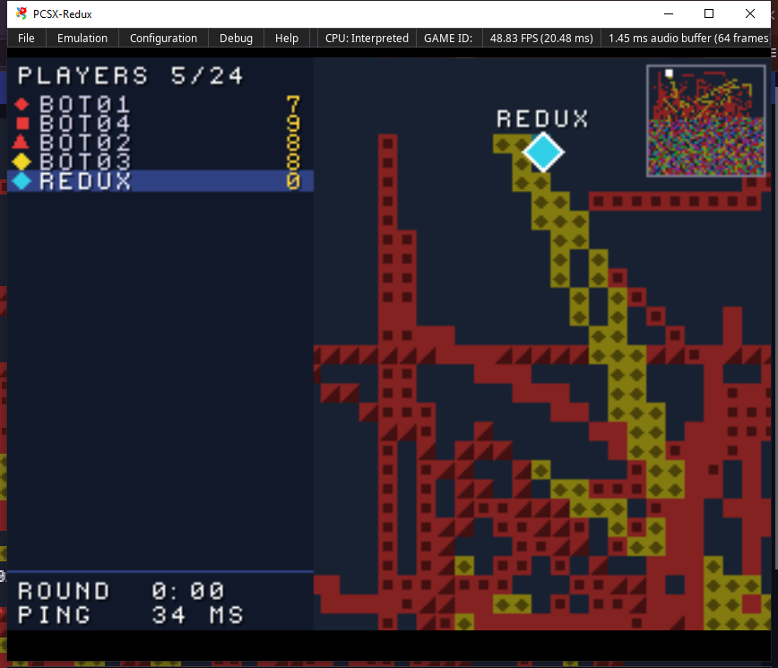
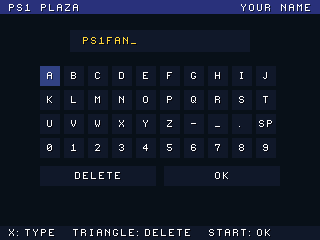
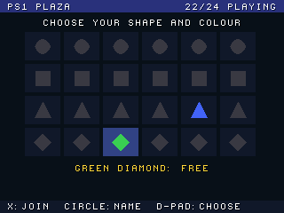

# PS1 PLAZA

An online game for up to 24 PlayStations at once, played over the internet through the PS1 DEV CART. It shows what
an online or MMO-style game can do on the console: everyone in one shared world, at the same time, each from their own
home.

  

Each player is a coloured shape: 4 shapes × 6 colours gives one each for 24 players. The tiles you move over take your
colour, and whoever holds the most tiles when the 3-minute round ends wins.
- **The player list** on the left shows everyone connected and their share of the board, with the round time and your
  ping.
- **The world** is 4 × 3 screens, with a camera that follows you and a minimap of the whole thing.
- **Quick chat** on the face buttons shows speech bubbles above your shape.

A few bots are always playing, so there's someone there even when you're on your own. You can watch the game live in
a browser at **https://ps1-plaza.logi26.co.uk**.

## Playing

You can play on a PlayStation with a PS1 DEV CART, or in the [PCSX-Redux](https://pcsx-redux.consoledev.net)
emulator on Windows without one. Players on consoles and in the emulator share the same world.

### In PCSX-Redux (no cartridge needed)

Install PCSX-Redux, then run:

    redux.bat

It starts PCSX-Redux with the game and connects it to the server, and you play in the emulator's window. Close
PCSX-Redux to leave.
- **Finding Redux:** `redux.bat` looks on the PATH and in the copy installed by the PSX.Dev extension for VS Code.
  Otherwise, tell it where Redux is: `redux.bat -Redux C:\path\to\pcsx-redux.exe`.
- **Your settings:** PCSX-Redux runs with its own copy of your usual settings (BIOS, controls), in `.redux\` next to
  the script, with its serial port switched on. Your own settings aren't changed.

  

### On a PlayStation

With the cartridge connected to your computer by USB, run:

    run.bat

With more than one cartridge connected, give the serial number (`ps1transfer -list` shows them):

    run.bat -n A10PVL53

### Joining

1. Type your name: **X** types the selected letter, **Triangle** deletes, **Start** is done.
2. Choose a shape and colour. Taken ones are greyed out with their player's name, and a free one is selected for you.
   **X** joins.
3. Play.

  
  

| Button | In the game |
|---|---|
| D-pad or left stick | Move |
| Triangle / Circle / Square / Cross | Quick chat: "HI!", "GG!", "FOLLOW ME!", "OVER HERE!" |
| Select | Name tags on/off |
| Start | Minimap on/off |

If the connection drops, the game says so. Run `run.bat` or `redux.bat` again to rejoin.

## How it works

The game only exchanges bytes with the server. Something on the computer passes them on over the internet (TCP):

- **On a PlayStation:** `ps1transfer -net play.logi26.co.uk:7020` is the bridge. It passes the bytes of the game's
  psxcomb USB link to the server.
- **In PCSX-Redux:** the game sends and receives through the emulated serial port (SIO1). Redux makes that port
  available on a local network port in raw mode, and `redux.ps1` passes the bytes between it and the server.
- **Choosing:** the game picks its link when it starts. PCSX-Redux identifies itself to programs, and on a console
  the cartridge's firmware is there.
- **Never waiting:** the game reads and writes the link without waiting, so the network never holds up a frame.

- **The server holds the shared world:** who is connected, the board, the scores and the round.
- **Moving.** Your own shape moves at once, and its position is sent about 17 times a second.
- **Updates.** The server sends 20 updates a second: the players near you in every one, and everyone's 4 times a
  second for the minimap. The painted tiles go to everyone, so the board is the same on every screen. Showing each
  player only what's near them is how online worlds keep traffic down as players are added.
- **Joining.** The whole board (8.6 KB) is sent when you join.
- **Smooth movement.** Other players glide to their latest position between updates.

With 24 players each console receives about 2–3.5 KB/s. That's a small part of what the USB link carries at full
frame rate (about 24 KB/s), and the game stays at 50/60 fps. Played from the Netherlands on a server in the UK, the
ping was about 140 ms. In PCSX-Redux the ping is a little lower, because there's no USB link in the way (34 ms
against 40 ms on the server's own network).

The messages between the game and the server are described in [plaza.h](plaza.h). A game of your own can use the same
pattern and a server of your own:
- **On a console:** psxcomb's USB link and `ps1transfer -net`.
- **In PCSX-Redux:** the serial port and a bridge.

## Building

`plaza.ps-exe` is included. To build it, with PSn00bSDK set in `config/Makefile.conf` as for the PlayStation tools:

    make

It uses the repo's psxcomb (`../../psxcomb`) and `psn00b_tool.mk`.
